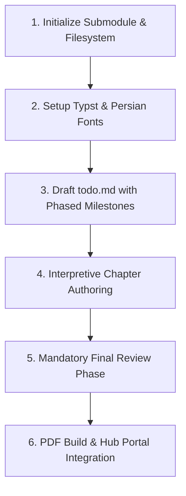

# Technical Book Translation & Publishing Skill

This skill provides the end-to-end procedural guide for translating and publishing technical books (DevOps, Cloud, Systems) into high-quality Persian PDF documents and web portal entries.

## Workflow Overview



---

## Step 1: Submodule Initialization
When adding a new technical book to the Hub:
1. Create a dedicated Git repository for the book (e.g., `the-kubernetes-book-2025-fa`).
2. Add it as a Git Submodule inside the Hub:
   ```bash
   git submodule add <repo-url> books/<book-slug>
   ```
3. Initialize the standard book repository structure:
   - `book.typ`: Master compilation document
   - `template.typ`: Page geometry, typography, and custom callouts (`note`, `tip`, `warning`, `concept`, `fig`)
   - `chapters/`: Individual chapter files (`00_preface.typ`, `01_primer.typ`, ...)
   - `fonts/`: TrueType fonts (Vazirmatn family)
   - `images/`: High-resolution figures and architecture diagrams
   - `todo.md`: Phased tracker
   - `GEMINI.md`: Local symlink or copy of project terminology rules

---

## Step 2: Typesetting & Font Setup
Configure `template.typ` for Persian RTL typesetting with Typst:
```typst
#let project(title: "", author: "", translator: "", body) = {
  set document(title: title, author: author)
  set page(
    paper: "a4",
    margin: (top: 2.5cm, bottom: 2.5cm, inside: 2.8cm, outside: 2.2cm),
    header: [...],
    footer: [...]
  )
  set text(
    font: "Vazirmatn",
    lang: "fa",
    dir: rtl,
    size: 10.5pt
  )
  set par(justify: true, leading: 0.9em)
  body
}
```

---

## Step 3: Phased `todo.md` Generation
Create `todo.md` in the book root. It **MUST** follow this phased pattern:
- **Phase 0:** Setup Typst, download Vazirmatn fonts, create layout template, verify RTL rendering.
- **Phases 1 to N:** Thematic chapter blocks (3 to 4 chapters per phase).
- **FINAL MANDATORY PHASE: Phase Review (`فاز بازبینی و تضمین کیفیت نهایی`):**
  - [ ] Terminology audit (grep for forbidden literal translations: `مقیاس`, `استقرار دادن`, `حافظه پنهان`).
  - [ ] Unify Developer Persian loanwords (`اسکیل کردن`, `دیپلویمنت`, `پایپ‌لاین`).
  - [ ] Typst compilation test with zero errors and zero missing-font warnings.
  - [ ] Figure numbering and caption alignment check.
  - [ ] Complete technical glossary chapter check.

---

## Step 4: Interpretive Chapter Translation (Developer Persian)
Follow these translation guidelines:
1. **Never translate literally.** Interpret the architectural purpose. Explain concepts as an expert Senior DevOps/Software engineer.
2. **Preserve book structure.** Keep all sections, sub-sections, code snippets, notes, and warnings.
3. **Use Developer Persian.** Keep standard terms (`Scale`, `Deploy`, `Cluster`, `Pod`, `Ingress`) or their accepted transliterations (`اسکیل`, `دیپلوی`).
4. **Initial Reference:** Mention the concept in natural Persian followed by English in parentheses on first appearance:
   - Example: `اسکیل دستی و خودکار (Scaling)`
   - Subsequent mentions: `اسکیل کردن`

---

## Step 5: Final Review & Typst Compilation
Run the compilation command pointing to the local fonts directory:
```bash
typst compile --font-path fonts book.typ <book-name>-Persian.pdf
```
Check for:
- Font warnings (ensure all `Vazirmatn` font variants are recognized).
- Text overflow or broken code listings.
- Missing image references.

---

## Step 6: Portal Integration
1. In the Hub repo, create a Hugo metadata file under `content/books/<book-slug>.md`:
   ```markdown
   ---
   title: "کتاب کوبرنتیز (ویرایش ۲۰۲۵)"
   originalTitle: "The Kubernetes Book (2025 Edition)"
   author: "نایجل پولتون (Nigel Poulton)"
   translator: "مجموعه مهندسی DevOps"
   pages: 280
   downloadUrl: "https://github.com/user/book-repo/releases/latest/download/book.pdf"
   featured: true
   tags: ["Kubernetes", "DevOps", "Cloud-Native", "Containers"]
   ---
   ```
2. Build the Hugo site:
   ```bash
   hugo --minify
   ```
