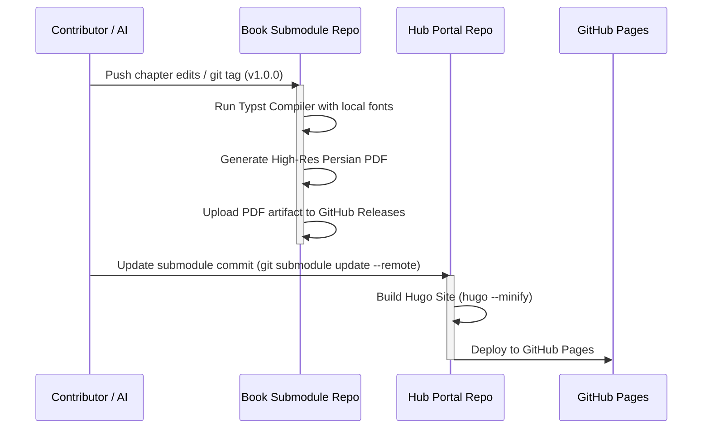

# Architecture & Technical Design: Open DevOps Books Hub

This document describes the architectural design, repository structure, publishing pipelines, and contributor guidelines for the **Open DevOps Books Hub**.

---

## 1. High-Level System Architecture

The project decouples web presentation from book authoring using a **Federated Hub & Submodule Architecture**:

```
                       ┌───────────────────────────────┐
                       │   book/ (Central Hub Repo)    │
                       │   - Hugo Static Site Generator│
                       │   - Global RTL / Dark Styles  │
                       │   - Books Catalog & Landing   │
                       └───────────────┬───────────────┘
                                       │
            ┌──────────────────────────┴──────────────────────────┐
            ▼                                                     ▼
┌──────────────────────────────┐              ┌──────────────────────────────┐
│ books/the-kubernetes-book-25 │ (Submodule)  │ books/linux-in-action        │ (Submodule)
│ - Typst Engine (book.typ)    │              │ - Typst Engine (book.typ)    │
│ - Chapters (00 to 19.typ)    │              │ - Chapters (.typ)            │
│ - Images & Fonts (Vazirmatn) │              │ - Images & Fonts             │
│ - todo.md (Phased + Review)  │              │ - todo.md (Phased + Review)  │
│ - GitHub Action -> PDF       │              │ - GitHub Action -> PDF       │
└──────────────────────────────┘              └──────────────────────────────┘
```

---

## 2. Component Breakdown

### A. The Central Hub (`book/`)
- **Technology:** [Hugo Extended](https://gohugo.io/) (High-performance static site generator).
- **Purpose:** 
  - Showcase all translated books with synopsis, table of contents, author/translator credits, and direct download buttons.
  - Optional chapter-by-chapter web reader for selected titles.
  - Unified search, tag navigation (e.g. `Kubernetes`, `DevOps`, `Linux`, `Networking`), and GitHub Pages hosting.
- **Submodule Directory:** Submodules are registered under `books/<book-slug>/`.

### B. Individual Book Repositories (`books/<book-slug>`)
- **Technology:** [Typst](https://typst.app/) (Next-generation, fast typesetting system with native RTL & Persian font support).
- **Structure:**
  ```text
  book-submodule/
  ├── book.typ                # Root Typst file including chapters
  ├── template.typ            # Global layout, styling, and custom callouts
  ├── fonts/                  # Vazirmatn font family (Black, Bold, Regular, etc.)
  ├── images/                 # Architecture diagrams and figures
  ├── chapters/               # Sequenced chapter Typst files
  ├── todo.md                 # Project tracker with mandatory Review phase
  └── .github/workflows/      # Automated compilation & PDF release publishing
  ```

---

## 3. The Continuous Integration & Delivery Pipeline (CI/CD)



---

## 4. Operating Guidelines for AI Agents

When an AI agent (Gemini, Claude, GPT, etc.) is asked to work on a book:

1. **Understand the Scope:**
   - If working on site layouts or catalog metadata: Operate in `book/` (Hub).
   - If writing or translating a book: Navigate to the corresponding `books/<slug>/` submodule.
2. **Consult [AGENTS.md](AGENTS.md):**
   - Strictly follow the Developer Persian terminology lookup table.
   - Never use literal calques for software engineering jargon (`Scale`, `Deploy`, `Pipeline`).
3. **Execute via `todo.md`:**
   - Check off completed chapters in `todo.md`.
   - Never mark the book complete without executing the **Final Review Phase** (terminology grep, Typst zero-warning build test, glossary review).
